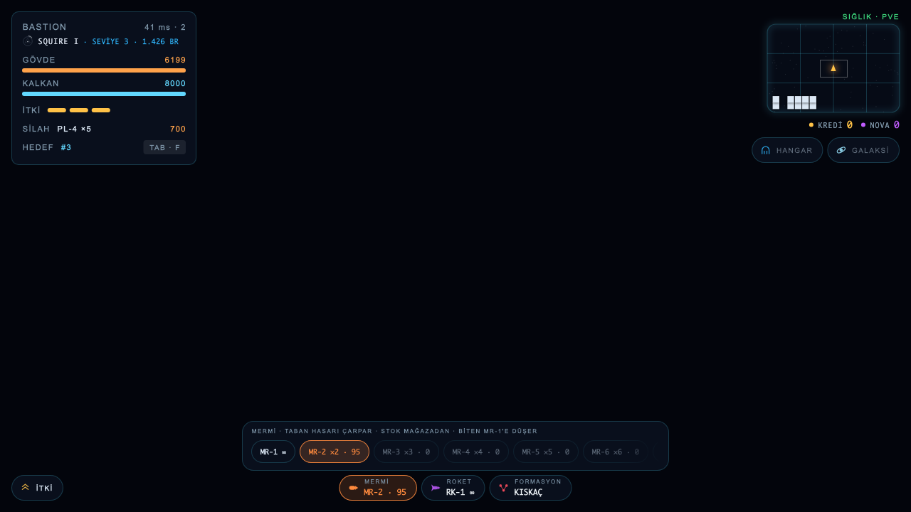
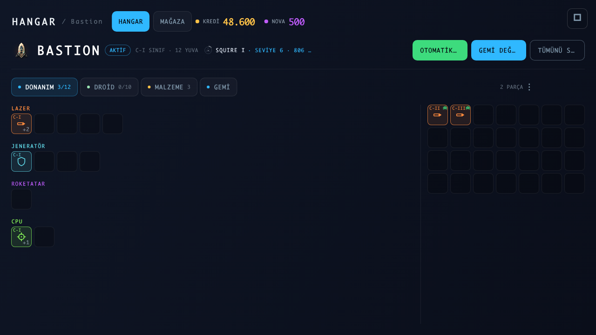
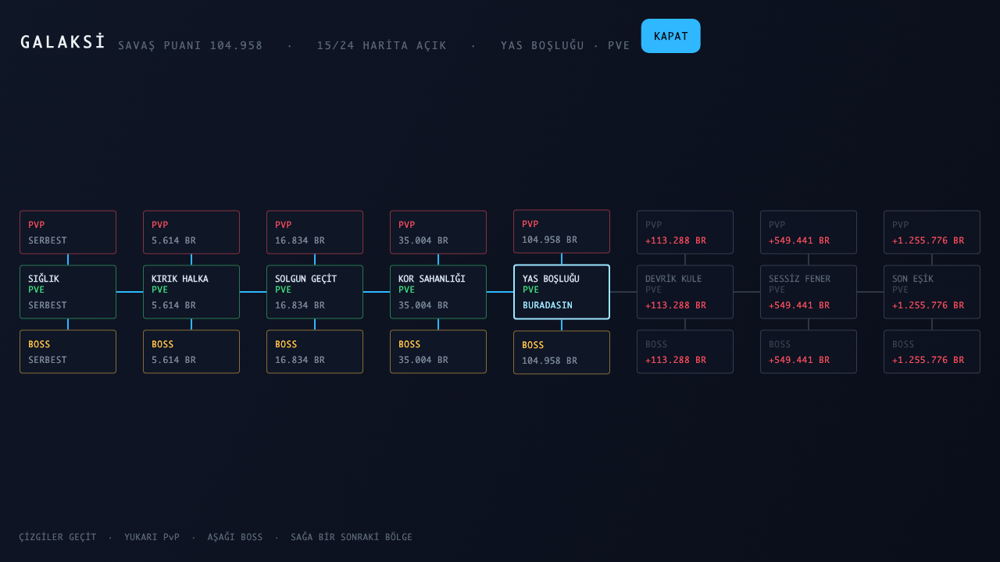
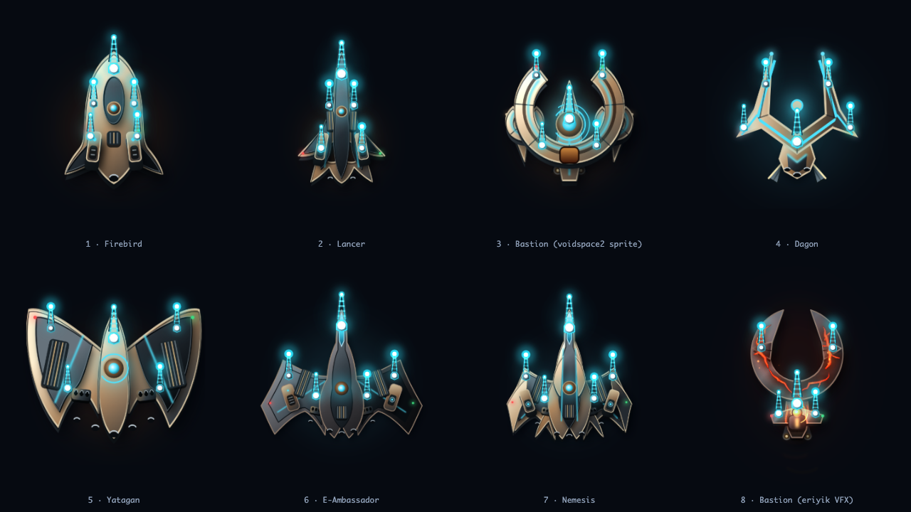
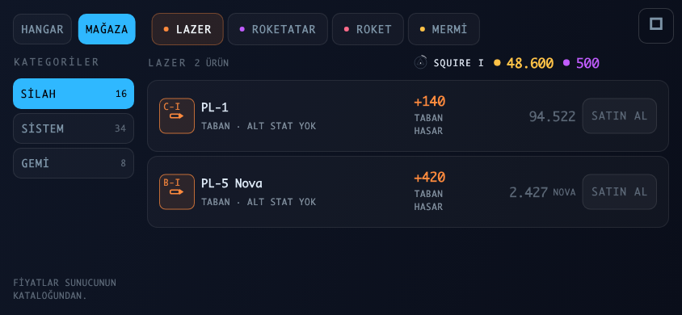

# Voidspace

**A real-time multiplayer space MMO built entirely in Dart: a Flutter + Flame client, an authoritative Dart server, and a pure-Dart simulation core that both sides share.**

Dozens of players fly the same map at once, see each other and fight. There is no single-player mode. Targets: **macOS, iOS, Android.**

| | |
|---|---|
|  |  |
|  |  |

<p align="center"></p>

> The UI is in Turkish (the game ships with three languages). All screenshots above are golden images rendered by tests in [`tool/`](tool/), so they always match the current code.

## At a glance

| | |
|---|---|
| Client | Flutter, Flame, flutter_bloc (`lib/`, ~30k lines) |
| Server | Pure Dart, AOT-compiled, WebSocket, no Flutter (`server/`, ~6.5k lines) |
| Shared core | Simulation, protocol, design numbers (`packages/voidspace_core/`, ~20k lines) |
| Tests | 160+ test files, ~1,500 test cases, ~39k lines of test code |
| Persistence | JSON Lines stores + an append-only transaction ledger |

## Architecture

One rule shapes the whole project:

> **Bloc *reflects* discrete state. Flame *draws* the continuous simulation. `voidspace_core` *defines* the simulation. The server *owns* the truth.**

The dependency direction is not a convention. It is locked by [`test/architecture_test.dart`](test/architecture_test.dart):

| Layer | Must not know about |
|---|---|
| `packages/voidspace_core/` | any package at all: no Flutter, Flame, Bloc, not even `dart:ui` |
| `server/` | Flutter, Flame, rendering |
| `server/lib/gateway.dart` | the simulation (game logic lives in `zone.dart`) |
| `lib/net/` | Flutter, Flame, HUD |
| `lib/game/art/` | state: Bloc, core, components, network |
| `lib/game/components/` | the game loop and the transport, they only receive a *pose* |
| `lib/hud/` | the simulation, it reads state only from Bloc |
| `lib/ship/` | the transport, the Bloc is a replica and never sees the socket |

### Why a single Dart codebase

A simulation can't be written twice. The client predicts its own ship to hide latency, and the server runs the same step as the authority. If both sides don't call **the same function**, results drift apart and players teleport, the most expensive class of netcode bug. `ShipSim.step` lives in exactly one place, so it can't drift.

## Netcode

```
client → server   input frames, sequenced, 30 Hz
server            fixed 30 Hz tick, ALL authority lives here
server → client   snapshot every tick, interest-filtered, delta-compressed
client            own ship: prediction + reconciliation (replay)
                  others: interpolated with an adaptive 2–12 tick (66–400 ms) buffer
```

The client never computes outcomes. It sends intent, and every check happens on the server.

## Security and robustness

[`server/test/security_test.dart`](server/test/security_test.dart) is different from the other tests: each test reproduces an **attack**, not a feature. Identity floods, connection caps, frame floods, oversized frames, debug commands in production, token lifetime, backpressure. Most were written right after closing a hole that was actually open.

Other things that are handled on purpose:

- Graceful shutdown on both `SIGINT` and `SIGTERM` (so it works inside Docker)
- Optional TLS (`wss://`) with real certificates, cleartext only for local development
- Per-IP socket limits, per-zone player capacity
- Platform setup that only shows up on real devices: iOS local network permission, Android cleartext allowed only in the debug manifest
- A latency proxy (`server/bin/lagproxy.dart`) and a load-test bot fleet (`server/bin/loadtest.dart`) for testing under lag, jitter and packet loss

## Docs as the source of truth

Game design lives in [`docs/`](docs/): numbered, versioned design decisions across 18 areas (combat formula, stats, items, upgrades, loot, economy…). Code cites the decision it implements (`/// KARAR 06.5 s1`) and at least one test cites it too. A checker ([`tool/belge/`](tool/belge/)) runs inside `flutter test` and fails the build when docs and code drift apart. The number tables in `docs/` are generated from code, so they can't go stale.

Every hand-entered design number lives in one file, every derived number is computed in another. Hard-coding a derived value anywhere else is the one real architecture violation in the project.

The engineering log ([`docs/muhendislik/`](docs/muhendislik/)) records the reasoning, real bugs and measurements behind each decision. The docs are written in Turkish.

## Project layout

```
packages/voidspace_core/   pure Dart core: simulation, protocol, design inputs, checks
server/                    authoritative server, no Flutter, AOT-compiled
lib/                       Flutter client: app · auth · i18n · game · hangar · hud · net · perf · ship
tool/                      golden image sources + the docs checker
test/                      prediction, end-to-end network, architecture, HUD and docs tests
docs/                      design documents + engineering log
```

## Running it

Server and client together (they also shut down together):

```bash
tool/dev.sh -d macos        # or: -d ios (simulator), -d android
BOTS=20 tool/dev.sh         # with bots on the map
```

`tool/dev.sh` also picks the right server address for the target: `localhost` for macOS and the iOS simulator, `10.0.2.2` for the Android emulator, your machine's LAN address for a physical phone.

Or start them by hand:

```bash
PORT=8080 dart run server/bin/server.dart
flutter run -d macos --release --dart-define=VOIDSPACE_SERVER=ws://localhost:8080
```

## Tests

```bash
dart test packages/voidspace_core   # simulation + protocol (under a second)
dart test server                    # authority, anti-cheat rules, attacks
flutter test                        # prediction, end-to-end network, architecture, HUD, docs
flutter test tool/                  # golden images
```

End-to-end tests use a **real** server and real sockets. A fake transport would skip exactly what they need to prove: encoding, reconciliation and tick timing. Each test file declares its kind with `@Tags`, so timing-sensitive tests can be excluded on a loaded machine with `--exclude-tags zaman`.

A fix is only trusted after its test was seen failing with the fix reverted.

## Art

No purchased asset packs. Ships and effects are either drawn procedurally in code (`lib/game/art/`) or come from sprites whose origin is written next to them (`assets/**/README.txt`). Every generated image in the repo has a test that produces it.

---

A longer Turkish README with more operational detail is in [README.tr.md](README.tr.md).

Built by **Muhammed Ali Çınar**, senior Flutter & iOS developer.
